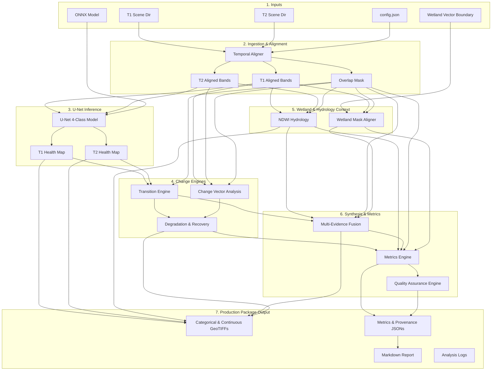

# GIS Wetland Degradation & Depletion Engine — Architecture Documentation

This document describes the high-level architecture, module organization, data flows, and the 16-step pipeline execution sequence of the GIS Wetland Degradation & Depletion Engine V1.

---

## 1. High-Level Architecture

The engine is designed as a modular, feed-forward processing pipeline for Sentinel-2 satellite imagery. It operates on two dates ($T_1$ and $T_2$) to detect vegetation degradation and surface-water change, synthesizing the results to report ecological change evidence.

The architecture is strictly separated into:
1. **Core Processing Modules**: Unwrapped, scientific logic modules executing individual steps (e.g. alignment, model inference, transition analysis, NDWI water change, fusion).
2. **Canonical Orchestration Layer**: The `ProductionPipeline` class that orchestrates execution, creates output directory packages, logs execution progress, manages errors, and exports metadata.
3. **Public API Service & CLI**: Lightweight entry points wrapping the orchestrator for programmatic or script-based invocation.



---

## 2. Module Directory Structure

The codebase is organized as follows:

```
src/gis_engine/
├── __init__.py
├── api/
│   ├── __init__.py
│   └── service.py         # Public API entry point (analyze_wetland)
├── core/
│   ├── __init__.py
│   ├── constants.py       # Single Source of Truth (SSOT) constants
│   ├── exceptions.py      # Structured exception hierarchy
│   ├── config.py          # Configuration loader and snapshot utility
│   ├── results.py         # AnalysisResult and TwoDateInferenceResult dataclasses
│   ├── pair.py            # Phase 3 vegetation health coordinator
│   └── pipeline.py        # Phase 13 Canonical Production Pipeline
├── alignment/
│   ├── __init__.py
│   ├── spatial.py         # Spatial aligner, grid validators
│   └── temporal.py        # Temporal aligner orchestrator
├── ingestion/
│   ├── __init__.py
│   ├── loader.py          # Band finder and GeoTIFF reader
│   ├── metadata.py        # RasterMetadata class
│   └── validator.py       # Input file and array validators
├── preprocessing/
│   ├── __init__.py
│   ├── bands.py           # Reflectance scaling
│   ├── indices.py         # NDVI, GNDVI, NDRE processor
│   ├── normalization.py   # Tensor min-max normalizer
│   └── tensor.py          # 5-channel tensor builder
├── inference/
│   ├── __init__.py
│   ├── onnx.py            # ONNX model execution with GPU fallback
│   ├── model.py           # Coordinator for single-date inference
│   └── probabilities.py   # Softmax and confidence calculator
├── change/
│   ├── __init__.py
│   ├── transition.py      # Post-classification transition engine
│   ├── cva.py             # Change Vector Analysis
│   ├── degradation.py     # Degradation & Recovery engine
│   └── fusion.py          # Multi-evidence fusion layer
├── wetland/
│   ├── __init__.py
│   ├── boundary.py        # GeoJSON/Shapefile ingestion
│   ├── mask.py            # Wetland mask rasterizer (aligned to grid)
│   └── water.py           # NDWI calculation & water change
├── metrics/
│   ├── __init__.py
│   ├── area.py            # Equal-area pixel metric calculator
│   └── degradation.py     # NDR & severity-weighted metrics
├── validation/
│   ├── __init__.py
│   ├── quality.py         # Quality Assurance Engine
│   ├── calibration.py     # Model calibration checker (deferred in V1)
│   └── olofsson.py        # Olofsson area uncertainty correction
└── output/
    ├── __init__.py
    ├── geotiff.py         # Colormapped GeoTIFF exporter
    ├── json.py            # JSON file exporter
    └── report.py          # Markdown report generator
```

---

## 3. The 16-Step Pipeline Execution Sequence

A production run executes exactly the following steps in sequence:

1. **Load Configuration**: Parse and validate `config.json`. Ensure all required ingestion, preprocessing, water, and model keys are present.
2. **Validate Inputs**: Ensure T1 and T2 scene folders exist, the ONNX model file exists, and temporal ordering is valid ($T_1 \text{ date} < T_2 \text{ date}$).
3. **Spatial/Temporal Alignment**: Run the `TemporalAligner` to calculate the spatial overlap mask, common reference grid, and reproject/resample the bands of $T_2$ to match the spatial geometry of $T_1$. Write the aligned band rasters and the `overlap_mask.tif` to the run's `alignment/` directory.
4. **Vegetation Inference**: Load the aligned bands from disk, compute the indices (NDVI, GNDVI, NDRE), build the 5-channel model input tensor, and invoke the ONNX model (with observable CPU fallback logging) to produce $T_1$ and $T_2$ class maps and confidence rasters. Save `t1_health.tif` and `t2_health.tif` to `vegetation/`.
5. **Transition Engine**: Run the post-classification transition engine over the class maps and overlap mask, computing a deterministic 4x4 row-major transition map. Save `transition_map.tif` to `change/`.
6. **Change Vector Analysis (CVA)**: Compute NDVI, GNDVI, and NDRE delta bands and CVA magnitude over the valid overlap mask. Save `cva_magnitude.tif` and delta bands to `change/`.
7. **Degradation & Recovery**: Combine post-classification transitions with CVA magnitudes and delta ndvi to categorize degradation, recovery, canopy loss, and residual stress maps. Save maps to `degradation/`.
8. **Wetland Context**: Reproject and rasterize the optional wetland boundary vector file to align precisely with the common reference grid. Save `wetland_mask.tif` to `wetland/`.
9. **NDWI Hydrology**: Ingest aligned green and nir bands from the alignment folder to calculate $T_1$ and $T_2$ NDWI rasters, classify water, and compute water transition change map. Save maps to `hydrology/`.
10. **Multi-Evidence Fusion**: Synthesize post-classification transitions and water change map to classify hydro-ecological evidence (such as surface-water loss, vegetation degradation, or combined hydro-ecological degradation). Save `evidence_fusion.tif` and `evidence_level.tif` to `fusion/`.
11. **Metrics Calculation**: Compute equal-area pixel metrics, transition matrices, Normalized Degradation Ratio (NDR), and severity-weighted degradation areas. Save `metrics.json`, `transition_matrix.csv`, and `evidence_matrix.csv` to `metrics/`.
12. **Quality Assurance**: Run the QA engine checking for spatial shifts, input data bounds, CRS validity, and metadata availability. Save `qa_report.json` to `validation/`.
13. **Assemble Result Package**: Collect all computed scalar values, status codes, warning logs, and file paths into a flat `analysis_result.json` dictionary.
14. **Generate Analysis Report**: Write the comprehensive Markdown `analysis_report.md` covering all 20 required report sections.
15. **Write Provenance metadata.json**: Record software version, git commit, runtime environment, input file footprints (SHA-256), and configuration hashes.
16. **Write manifest.json**: List all generated outputs, including file sizes and SHA-256 hashes, to guarantee package integrity.

---

## 4. Single Source of Truth (SSOT)

All modules reference the centralized `src/gis_engine/core/constants.py` file to resolve:
- NoData definitions (`NODATA_CATEGORICAL = 255`, `NODATA_CONTINUOUS = -9999.0`).
- U-Net class IDs (`CLASS_ID_BACKGROUND = 0`, `CLASS_ID_SEVERE = 1`, `CLASS_ID_MODERATE = 2`, `CLASS_ID_HEALTHY = 3`).
- Transition IDs (row-major mapping).
- Vegetation degradation indices (`DEGRADATION_IDS = {9, 13, 14}`).
- Water state IDs and Fusion Category IDs.
- Channel ordering (`["ndvi", "gndvi", "ndre", "nir", "rededge"]`).

This prevents compilation drift and guarantees that downstream reporting always aligns with intermediate processing stages.
